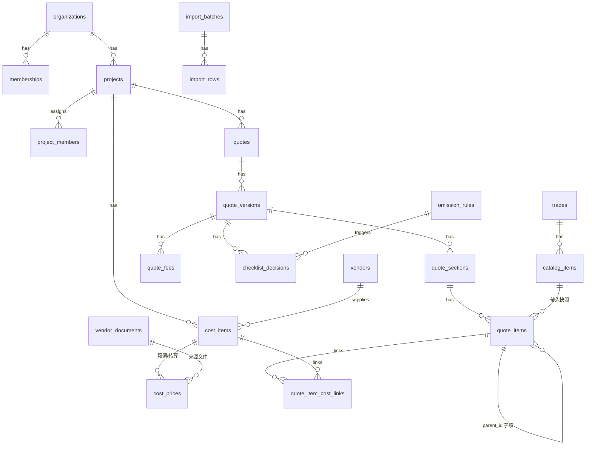

# 架構與開發計畫（草案 v1）

- 日期：2026-10-20
- 狀態：**已確認（2026-10-20）**，§6 的 R1～R8 全部採用建議。決策記錄在 [CLAUDE.md](../CLAUDE.md)（D1～D8）。
- 文中 🆕 = 因 2026-10-20 決策新增或修改的部分；❓ = 需要你確認。

---

## 1. 技術架構

| 層 | 選擇 | 理由 |
|---|---|---|
| 前後端 | Next.js（App Router）+ TypeScript | 依需求 |
| UI | Tailwind CSS + shadcn/ui + Framer Motion | 依需求；動畫一律搭配 `prefers-reduced-motion` |
| 資料庫 | Supabase Postgres（東京）+ RLS | 多租戶隔離在資料庫層完成 |
| ORM | **Drizzle**（建議，不用 Prisma） | 遷移檔是純 SQL，RLS policy、`numeric`、trigger 都能直接寫在遷移裡；Prisma 對 RLS 的支援要繞路 |
| 驗證 | Supabase Auth | 內建 bcrypt 雜湊、TOTP 雙重驗證、登入次數限制，不自己寫加密邏輯 |
| 檔案 | Supabase Storage（S3 相容、伺服器端加密）| 私有 bucket，只透過有時效的簽名網址下載 |
| PDF | **React-PDF**（建議，不用 Playwright） | Vercel serverless 跑 Playwright 太重；React-PDF 可以嵌入 Noto Sans TC |
| 金額 | Postgres `numeric` + `decimal.js` | 禁止浮點數 |
| 欄位加密 | Node `crypto` AES-256-GCM，金鑰放環境變數 | 加密欄位另存 HMAC「盲索引」，讓電話、Email 仍能精確查詢 |
| 測試 | Vitest（計價、規則引擎）、pgTAP（RLS）、Playwright（E2E）| 計價、權限、版本凍結、防漏項都要有測試 |

---

## 2. 計價核心定義（依 D1、D2、D4）

### 2.1 單一報價項目

```
對客總價   = 對客單價 × 數量（不計入合計的項目：選配、管銷服務、業主自備 → 不加總）
項目成本   = Σ（連結到此項目的成本項目「有效成本」× 分攤比例）
有效成本   = 有結算 → 結算金額；否則 → 最新一次報價金額
毛利       = 對客總價 − 項目成本
加成率     = 對客總價 ÷ 項目成本（成本為 0／空白 → 「—」）
毛利率     = 毛利 ÷ 對客總價（對客總價為 0 → 「—」）
成本來源標籤 = 「結算」／「報價（2025-07-14）」／「混合」（連到多個來源不同的成本項目時）
```

### 2.2 報價單總計（🆕 ❓ 計算順序待確認，見 §6 R1）

```
① 計入管銷小計 S1  = Σ 計入管銷項目的對客總價
② 不計管銷小計 S2  = Σ 不計入管銷、但由公司收款的項目（代購）
③ 工程管理費 F     = S1 × 案場管銷比例（預設 10%）
④ 其他浮動費用 D   = 設計費、保固金等（% 或固定金額）
⑤ 折讓 X
⑥ 未稅合計 N       = S1 + S2 + F + D − X
⑦ 營業稅 T         = 外加：N × 5%；內含：總價 × 5/105（僅顯示）
⑧ 總計             = N + T（外加）或 N（內含）
業主直付項目：不在 ①～⑧ 之內
```

總計旁顯示：`總成本 / 總毛利 / 毛利率`，以及成本來源統計「12 項結算／5 項報價」。

---

## 3. 資料模型（ERD）

所有表皆有 `id (uuid)`、`organization_id`、`created_at`、`updated_at`、`created_by`；以下省略。🔒 = 欄位級加密。



### 3.1 租戶、帳號、權限

| 表 | 主要欄位 | 說明 |
|---|---|---|
| `organizations` | name, 🆕 `default_mgmt_fee_rate`（預設 0.10）, default_tax_mode, retention_years, 🆕 `confidence_thresholds`（jsonb） | 公司層設定 |
| `memberships` | user_id, role（admin / designer / supervisor）, can_view_unit_price, can_view_cost | 「看單價」「只看總價」個別權限 |
| `project_members` | project_id, user_id | 專案隔離：沒被指派就看不到 |
| `audit_logs` | actor_id, action, target_type, target_id, metadata（不含個資）, ip | 登入、檢視個資、匯出 PDF、改價、刪除、權限變更 |

### 3.2 主檔

| 表 | 主要欄位 | 說明 |
|---|---|---|
| `trades`（工種） | name, sort, 🆕 `default_include_in_mgmt_fee`（預設 true）, 🆕 `is_proxy_purchase`（代購工種，預設不計管銷） | 使用者可增修 |
| `units` | name, sort | 式、坪、尺、才、組…可自訂 |
| `catalog_items`（品項主檔） | trade_id, name, unit_id, spec, default_vendor_id, pricing_method（單價×數量／按坪／一式／套裝／百分比）, note | 報價時帶入「快照」，主檔日後變動不影響已存在的報價 |
| `vendors` | name, trade_ids, contact_name, phone 🔒, tax_id, note | |

### 3.3 案場與業主

| 表 | 主要欄位 |
|---|---|
| `clients` | name 🔒, phone 🔒, email 🔒, national_id 🔒, 盲索引欄位 |
| `projects` | name, client_id, district（公開）, address_full 🔒, ping, condition（新成屋/中古屋/老屋）, floor, has_elevator, hoa_rules, status, 🆕 `mgmt_fee_rate`（null = 用公司預設）, tax_mode |
| `project_files` | storage_key, kind, is_deidentified |

### 3.4 報價單與版本

| 表 | 主要欄位 | 說明 |
|---|---|---|
| `quotes` | project_id, title | 一個案場可有多份報價單 |
| `quote_versions` | quote_id, version_no, status（draft / issued / signed）, issued_at, content_hash, 🆕 `mgmt_fee_rate_snapshot`, tax_mode, 總計快取 | issued 之後由 DB trigger 禁止修改 |
| `quote_sections` | version_id, trade_id, sort, footnote | 依工種分區；footnote 為頁尾工種附註 |
| `quote_items` | 見下表 | |
| `quote_fees` | version_id, kind（mgmt / design / warranty / discount / other）, mode（percent / fixed）, value | 管理費由系統計算，不手填 |
| `checklist_decisions` | version_id, rule_id, decision（add / skip / pending）, skip_reason | 略過原因留存供分析 |

**`quote_items` 欄位**

| 欄位 | 說明 |
|---|---|
| section_id, parent_id, sort, item_no_label | 母子結構（含附屬內容、「(上項)」） |
| catalog_item_id, name, unit_name, spec, note | 快照 |
| quantity `numeric(14,2)`, client_unit_price `numeric(14,2)` | |
| client_price_mode（auto / manual）, markup_rate_used | 對客價由「成本 × 加成率」帶出或手動覆寫 |
| is_optional, is_complimentary, is_owner_supplied, is_actual_cost, ref_price_min/max | 旗標（見盤點報告 §5.4） |
| 🆕 `is_paid_directly_by_owner` | 業主直付；為 true 時強制不計入管銷 |
| 🆕 `include_in_mgmt_fee` | 是否計入管銷 |
| 🆕 `include_in_mgmt_fee_source`（default / owner_direct / manual） | 記錄是預設、業主直付自動排除，還是設計師手動調整 |
| 🆕 `legacy_red_font` | 原表紅字，只有匯入資料會有值，無商業意義 |
| source_import_row_id | 追溯匯入來源 |

### 3.5 成本（🆕 依 D2 重新設計）

| 表 | 主要欄位 | 說明 |
|---|---|---|
| `vendor_documents` | project_id, vendor_id, trade_id, kind（quote / settlement）, document_date, file_id, note | 一張師傅報價單或結算單 |
| `cost_items` | project_id, vendor_id, trade_id, name, unit_name | 一個成本項目（有自己的名稱、單位，例：拆除 6.5 坪） |
| `cost_prices` | cost_item_id, 🆕 `source`（quote / settlement）, quantity, unit_price, amount, priced_on, vendor_document_id | **同一成本項目可有多筆報價、至多一筆有效結算** |
| `cost_adjustments` | vendor_document_id, label（優惠／補整數／預先追加）, amount, allocation（proportional / none） | 文件層級的調整 |
| `quote_item_cost_links` | quote_item_id, cost_item_id, allocation_ratio `numeric(7,6)` | 一對一、多對一、一對多。同一成本項目的比例加總 ≤ 1 |

**有效成本**用 SQL view `cost_item_effective` 計算（結算優先，否則取 `priced_on` 最新的報價），回傳 `effective_amount`、`effective_source`、`effective_date`。所有畫面與 PDF 都讀這個 view，確保標籤一致。

### 3.6 防漏項

| 表 | 主要欄位 | 說明 |
|---|---|---|
| `omission_rules` | name, conditions（jsonb：案場條件 + 已選工種/品項）, suggests（品項或工種）, message, status（draft / active / disabled）, origin（manual / suggested） | 規則存在資料庫，可在後台增修 |
| 🆕 規則建議欄位 | `sample_projects`, `support_count`, `confidence`（low / medium / high） | origin = suggested 時必填；**低信心規則不能一鍵啟用**，啟用前必須逐條確認 |
| `skip_reason_presets` | label | 業主自理、本案不需要… |

### 3.7 匯入（🆕 依 D3、D5 重新設計，第二階段實作，但結構第一階段就要留好）

| 表 | 主要欄位 | 說明 |
|---|---|---|
| `import_batches` | file_name, file_sha256, status, report（jsonb） | 同一個檔案（同雜湊）再匯入 → 直接提示「已匯入過」 |
| `import_sheet_mappings` | file_pattern, sheet_name, column_map（jsonb）, confirmed_by | 每頁欄位對應，你確認後才生效，下次同格式檔案自動套用 |
| `import_rows` | batch_id, **`source_key`**, `content_hash`, raw（jsonb）, `legacy_red_font`, status（staged / confirmed / skipped / conflict）, target_type, target_id | 見下方重跑規則 |

**重跑規則（可重複執行、不覆蓋已確認資料）**

- `source_key` = 案場 + 版本 + 工作表 + 項目編號 + 正規化品名（不用列號，因為插入列會讓列號位移）。
- 新的 `source_key` → 新增為 staged。
- 相同 `source_key`、相同 `content_hash` → 略過。
- 相同 `source_key`、內容不同：
  - 原本還是 staged → 更新
  - 原本已 confirmed → **不覆蓋**，標成 conflict，列入匯入報告，由你決定
- 匯入報告內容：新增 / 略過 / 衝突筆數，以及「原表紅字 vs 系統判定差異」的吻合率（D3）。

### 3.8 參考分析（🆕 依 D5）

`markup_reference`（materialized view，依工種）：樣本案場數、樣本項目數、加成率中位數、P25、P75、`confidence`。

信心等級門檻建議（❓ 見 §6 R6）：

| 樣本案場數 | 等級 | 畫面呈現 |
|---|---|---|
| 1～2 | 低信心 | 灰色＋「低信心・僅 1 案」，不得當成預設加成率 |
| 3～9 | 中信心 | 可帶入當建議值，需手動確認 |
| ≥ 10 | 高信心 | 可設為工種預設加成率 |

---

## 4. 畫面清單

| # | 畫面 | 階段 | 受本次決策影響 |
|---|---|---|---|
| 1 | 登入、雙重驗證設定 | 一 | |
| 2 | 案場列表（搜尋、狀態篩選） | 一 | |
| 3 | 案場新增／編輯（手機優先） | 一 | 🆕 案場管銷比例欄位 |
| 4 | 案場詳情：概要、檔案、成員 | 一 | |
| 5 | **報價單編輯器**（桌機表格；手機卡片） | 一 | 🆕 每列成本來源標籤、未計入管銷底色與標籤、業主直付切換、計入管銷切換；🆕 總計區：管理費、成本來源統計、加成率「—」 |
| 6 | 成本面板（在編輯器內展開）：師傅報價／結算、對應關係 | 一 | 🆕 報價 vs 結算多筆紀錄、有效成本標示 |
| 7 | 送出前檢查清單 | 一 | |
| 8 | 版本列表、版本並排比較 | 一 | |
| 9 | PDF 預覽：對客版／內部版 | 一 | 🆕 內部版標示未計入管銷；對客版呈現方式 ❓ R2 |
| 10 | 歷史價格抽屜（任何品項一鍵展開） | 一 | 🆕 成本價標示來源（報價／結算） |
| 11 | 品項主檔、工種、單位管理 | 一 | 🆕 工種「預設計入管銷」「代購工種」設定 |
| 12 | 廠商管理、廠商歷次報價 | 一 | |
| 13 | 防漏項規則管理 | 一 | 🆕 建議規則顯示樣本數與信心等級 |
| 14 | 公司設定（抬頭、Logo、預設管銷比例、稅、使用者與權限） | 一 | 🆕 預設管銷比例、信心門檻 |
| 15 | 稽核紀錄 | 一 | |
| 16 | 匯入工具：上傳 → 欄位對應確認 → 預覽 → 匯入報告 | 二 | 🆕 重跑規則、衝突處理、紅字吻合率 |
| 17 | 加成參考、規則建議 | 二 | 🆕 樣本數、低信心標示 |
| 18 | 追加減帳 | 二 | ❓ R3 |

---

## 5. 第一階段任務拆解

每項完成後提供本機測試方式。

| # | 任務 | 主要產出 | 測試重點 |
|---|---|---|---|
| 1 | 專案骨架 | Next.js、Tailwind、shadcn/ui、Drizzle、Supabase 本機環境、CI、`.env.example` | 本機啟動、lint、型別檢查 |
| 2 | 多租戶資料模型 + RLS | §3 全部資料表的遷移、RLS policy、虛構種子資料 | pgTAP：跨租戶讀不到、未指派案場讀不到、監工讀不到成本 |
| 3 | 登入與角色權限 | Supabase Auth、TOTP、Session 逾時、權限 middleware | 角色 × 頁面 × API 權限矩陣測試 |
| 4 | 欄位加密與稽核 | AES-256-GCM 工具、盲索引、`audit_logs` 寫入 | 加解密往返、金鑰缺失時拒絕啟動 |
| 5 | **計價核心函式庫**（純函式） | §2 全部公式、有效成本、管理費、稅、四捨五入 | 用敦化南路的**數字**（不含個資）寫成測試案例，驗證管理費 215,641 等結果 |
| 6 | 主檔：工種、單位、品項、廠商 | 畫面 11、12 | |
| 7 | 案場管理 | 畫面 2、3、4，檔案上傳（簽名網址） | 手機版新增案場 |
| 8 | 報價單編輯器 | 畫面 5、6；拖曳排序、複製、鍵盤操作（Tab、Enter 新增列）、數字鍵盤 | E2E：新增項目到總計正確 |
| 9 | 防漏項規則引擎 + 檢查清單 | 規則評估器（純函式）、畫面 7、13 | 需求 §3.6 的 6 條範例規則都有測試 |
| 10 | 版本凍結與比較 | DB trigger 禁止修改 issued 版本、畫面 8 | 凍結後 API 與直接 SQL 都改不了 |
| 11 | PDF 匯出 | 對客版、內部版（React-PDF + Noto Sans TC） | **對客版不得出現成本、廠商、毛利、加成率**的自動化測試 |
| 12 | 歷史價格查詢 | 畫面 10、價格趨勢圖 | |

---

## 6. 需要你確認的事項

### R1. 工程管理費與營業稅的計算順序（🆕 你要求的建議）

**建議**：依 §2.2 的順序，先算管理費，再算營業稅，營業稅的基礎包含管理費。

- 理由：管理費是公司的營業收入，本身也要開發票；敦化南路合約頁「總價含管理費（未稅）」也是這個順序。
- 折讓放在管理費之後、稅之前，**不影響管理費金額**。
- 代購（S2）列入營業稅基礎，前提是公司有開發票收這筆錢；業主直付不列入。
- ⚠️ 代購是否開發票、內含／外加的實務做法，**建議跟記帳士確認**。

### R2. 對客版 PDF 是否顯示「未計入管銷」（🆕 你要求的建議）

**建議**：不要逐列標示，改成**區段層級**呈現：

```
壹 拆除保護工程 ………… 162,000
…
工程小計 …………… 2,156,410
工程管理及重點監造 10% …… 215,641
────────────
代購項目（不計工程管理費）……  40,743
業主直接發包項目（不含於本報價總價）
  空調工程 — 由業主直接付款給廠商
```

- 理由：「管銷」是內部用語，逐列標籤會讓業主去逐項計較管理費；但業主有權知道哪些錢沒有算管理費，用區段標題就能清楚表達。這也和你們原本合約頁的寫法一致（「代購（未計入管銷）」「業主廠商（未計入管銷）」）。
- 設計師手動調成不計入的一般工程項目：對客版仍放在原工種區段，不另外標示。❓ 這樣可以嗎？

### R3. 追加減帳是否計入管銷（🆕 你要求的建議）

**建議**：計入，依每個項目自己的「是否計入管銷」欄位判斷（規則和報價項目相同）。

- 依據：敦化南路合約頁的工程總價 2,156,410 已包含「其他-追加減」30,350，管理費 215,641 正好是它的 10%。
- 追減會同步減少管理費。
- 每張追加減帳單列出「追加減小計＋對應管理費」，累計合約總額 = 原合約 + Σ（追加減 + 管理費）。
- 「管銷服務」（不另收費）項目金額為 0，自然不影響管理費。

### R4. 業主直付項目是否列在對客報價單上（🆕 你要求的建議）

**建議**：列出，放在 R2 的「業主直接發包項目」區段，**預設不顯示金額**（可逐項開啟顯示「參考金額」）。

- 理由：讓業主看見完整工程範圍，避免日後爭議「這個沒包含在裡面嗎」；也和原合約頁的「空調工程：業主廠商」寫法一致。

### R5. 結算金額只有整筆、沒有逐列時如何分攤（🆕 新問題）

原資料常見：師傅逐列報價，但結算只有一個總數（拆除報價明細 104,562.5，結算 120,000）。

**建議**：結算可以逐列輸入，也可以在「廠商文件」層級輸入整筆。整筆時，依各成本項目最新報價金額**按比例分攤**到各列，標籤顯示「結算（分攤）」。

### R6. 信心等級門檻

§3.8 的「1～2 案低、3～9 案中、≥10 案高」可以嗎？門檻會放在公司設定中，之後可以調整。

### R7. 成本變動後，自動帶出的對客價要不要跟著變（🆕 新問題）

例如：對客價原本是「報價成本 × 1.35」自動帶出，之後結算金額進來，成本變了。

**建議**：**不自動改**對客價（已報給業主的價格不該偷偷變動）。在該列顯示「成本已變動」提示，提供「依新成本重算」按鈕；已凍結的版本完全不受影響。

### R8. 上一輪報告中尚未回覆的事項

以下若不回覆，我會採用括號內的預設值：

| # | 事項 | 預設 |
|---|---|---|
| 盤點 4 | 15 張「○○工程」單價表 | 略過，不匯入 |
| 盤點 5 | 母項有子項金額時的總價 | 母項總價 = 自己的金額 + 有金額子項的加總；沒有金額的子項只當說明 |
| 盤點 6 | 四捨五入 | 每列小計四捨五入到元，總計 = 各列加總；管理費、稅各自四捨五入到元 |
| 盤點 8 | 管銷服務項目 | 對客版列出，金額欄顯示「管銷服務」 |
| 盤點 10 | 專案位置 | 建在根目錄 `interior-design/`，刪除空資料夾 `my-project/`、`my-new-project/` |
| 技術 | ORM、PDF | Drizzle、React-PDF（理由見 §1） |
